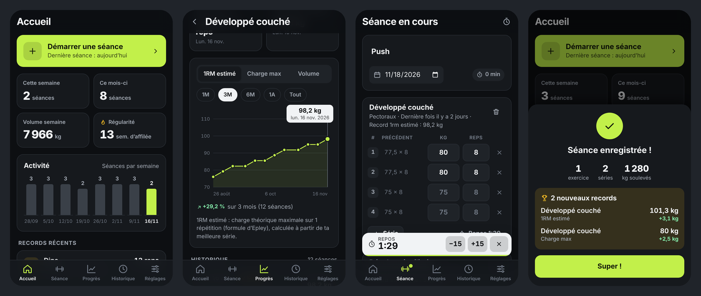

# Progression — suivi de tes performances en salle

Application web mobile (PWA) pour noter tes séances de musculation et **suivre ton évolution sur chaque exercice** : courbes de progression, records personnels, historique et régularité.



- 📱 S'installe sur l'écran d'accueil du téléphone comme une vraie appli
- ✈️ Fonctionne **hors-ligne** (pratique en salle sans réseau)
- 🔒 Aucune inscription : les données restent **sur ton appareil**
- 🧩 Aucune dépendance, aucun build : HTML + CSS + JavaScript

## Fonctionnalités

| Écran | Ce que tu peux faire |
|---|---|
| **Accueil** | Séances de la semaine et du mois, volume soulevé, semaines d'affilée, activité sur 8 semaines, derniers records, dernières séances |
| **Séance** | Créer une séance (vide ou en refaisant une séance passée), ajouter des exercices, saisir kg × reps (ou durée), voir la **performance précédente** série par série (un tap la recopie), minuteur de repos avec son et vibration, notes. Le brouillon est sauvegardé en continu : rien n'est perdu si tu fermes l'appli |
| **Progrès** | Tous tes exercices avec mini-courbe et tendance sur 3 mois, filtre par groupe musculaire |
| **Détail d'un exercice** | Records (1RM estimé, charge max, meilleure série, volume max…), courbe interactive par indicateur et par période (1 mois → tout), historique complet avec les séances record |
| **Historique** | Séances classées par mois ; détail, modification, suppression, « refaire cette séance » |
| **Réglages** | Durée du repos, gestion des exercices (créer, renommer, supprimer), export / import de sauvegarde (JSON), données de démo, remise à zéro |

### Trois types d'exercices

- **Charge** (kg × répétitions) : développé couché, squat… → 1RM estimé, charge max, volume
- **Poids du corps** (répétitions, lest optionnel) : tractions, dips… → reps max, reps totales, lest max
- **Durée** (secondes ou `mm:ss`) : gainage, corde à sauter… → durée max, durée totale

Le **1RM estimé** utilise la formule d'Epley : `charge × (1 + reps / 30)`.
Un **record** est détecté quand une séance bat ta meilleure valeur précédente (la toute première séance d'un exercice ne compte pas).

29 exercices courants sont fournis ; tu peux en ajouter autant que tu veux.

## L'utiliser sur ton téléphone

L'application doit être servie en HTTPS pour s'installer et fonctionner hors-ligne. Le plus simple : **GitHub Pages** (gratuit).

1. Fusionne cette branche dans `main`.
2. Sur GitHub : **Settings → Pages → Build and deployment → Source : Deploy from a branch**, choisis `main` et `/ (root)`, puis **Save**.
3. Après une minute, l'appli est disponible à l'adresse `https://<ton-compte>.github.io/app-salle-/`.
4. Ouvre ce lien sur ton téléphone puis :
   - **iPhone (Safari)** : bouton Partager → « Sur l'écran d'accueil »
   - **Android (Chrome)** : menu ⋮ → « Installer l'application » / « Ajouter à l'écran d'accueil »

> ⚠️ Les données sont stockées dans le navigateur de ton téléphone. Utilise de préférence l'appli **installée** (sur iPhone, Safari peut effacer les données des sites non installés après plusieurs semaines sans visite) et pense à **exporter une sauvegarde** de temps en temps (Réglages → Exporter).

## Lancer en local

```bash
npm start          # équivaut à : python3 -m http.server 8080
# puis ouvrir http://localhost:8080
```

## Tests

Les calculs (1RM, records, tendances, régularité…) sont testés avec le lanceur de tests intégré à Node (≥ 18) :

```bash
npm test
```

## Structure

```
index.html              Page unique + barre d'onglets
css/styles.css          Styles (mobile d'abord, thème clair / sombre automatique)
js/stats.js             Calculs purs : métriques, records, séries temporelles (testés)
js/store.js             Stockage local, exercices par défaut, validation des imports
js/chart.js             Graphiques SVG (courbe interactive, mini-courbes)
js/demo.js              Générateur de données de démo
js/app.js               Interface : vues, navigation, saisie, minuteur
sw.js                   Service worker (hors-ligne)
manifest.webmanifest    Installation sur l'écran d'accueil
tests/stats.test.js     Tests unitaires
```

Après une modification des fichiers de l'appli, incrémente `CACHE` dans `sw.js` (`progression-v2`, …) pour que les téléphones récupèrent bien la nouvelle version.
